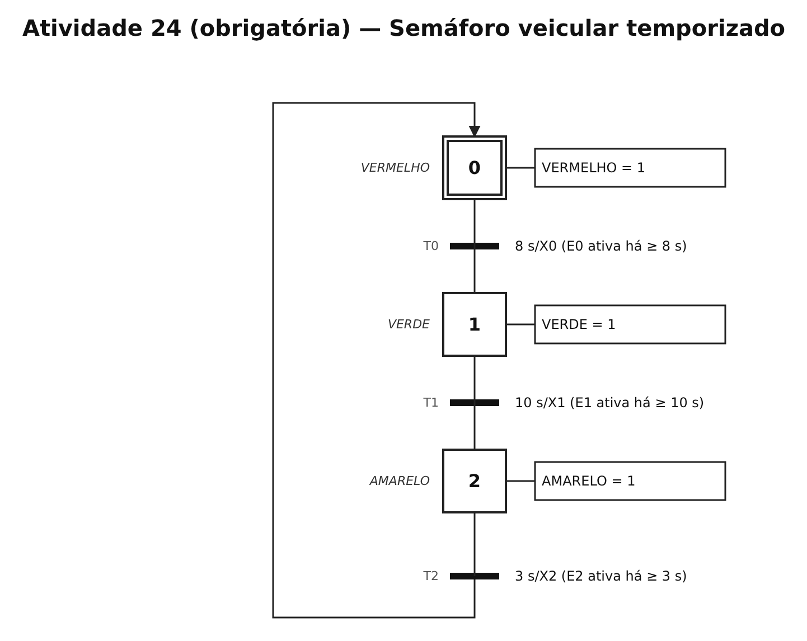
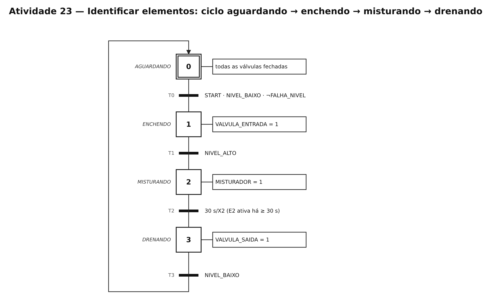
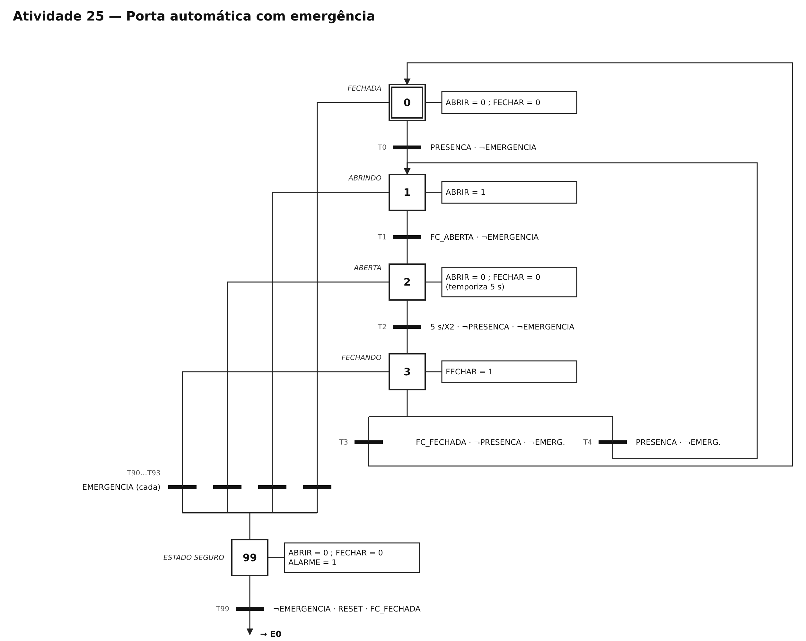
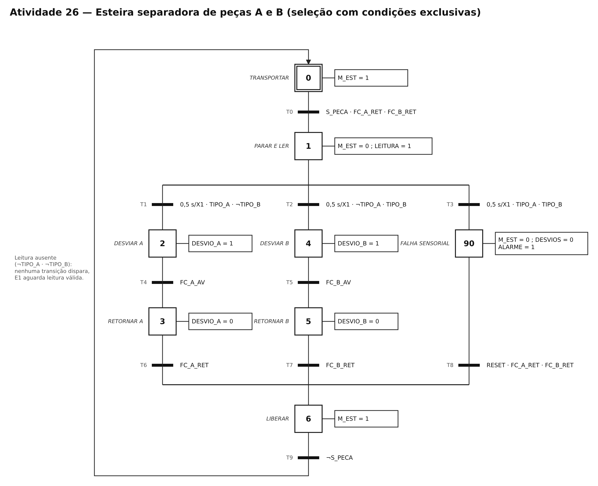

# TP05 — Sistemas sequenciais e GRAFCET/SFC

UC Sistemas Automatizados · Prof. Calvetti · Engenharia de Software — USJT
Murilo Amorim Castro (RA 823135117) · Data: 26/09/2026

## O que fiz

Desenhei em GRAFCET, no diagrams.net, quatro sistemas que funcionam em etapas: um reservatório (só para identificar as partes), o semáforo (obrigatório), uma porta automática com emergência e uma esteira que separa peças. Depois percorri cada modelo na mão para ver se ele faz o que deveria.

## Arquivos

| Arquivo | O que é |
|---|---|
| `grafcet.drawio` | arquivo editável, uma página por atividade |
| `semaforo.png` | atividade 24, obrigatória |
| `reservatorio.png` | atividade 23, identificar as partes |
| `porta.png` | atividade 25, porta com emergência |
| `esteira.png` | atividade 26, esteira separadora |
| `exemplo-esteira-atuador.png` | exemplo feito em aula |
| `casos_teste.csv` | 39 testes com esperado e obtido |
| `percurso_semaforo.csv` | atividade 27, percurso passo a passo |
| `NOTAS.md` | hipóteses, limites e melhorias |

## Como ler os desenhos

| Elemento | Como aparece |
|---|---|
| Etapa | quadrado numerado |
| Etapa inicial | quadrado com borda dupla |
| Ação | retângulo ao lado da etapa |
| Transição | barra preta entre etapas |
| Condição para passar | texto ao lado da barra |
| Tempo | `8 s/X0` quer dizer "E0 ativa há pelo menos 8 s" |
| Operadores | `·` = E, `+` = OU, `¬` = NÃO |
| Etapa de falha | E90 e E99, tudo que é perigoso em 0 |

## Atividade 24 (obrigatória) — Semáforo

| Etapa | Cor |
|---|---|
| E0 (inicial) | vermelho |
| E1 | verde |
| E2 | amarelo |

| Transição | De → para | Quando |
|---|---|---|
| T0 | E0 → E1 | depois de 8 s |
| T1 | E1 → E2 | depois de 10 s |
| T2 | E2 → E0 | depois de 3 s |

Testei logo antes e exatamente no tempo de cada troca:

| Caso | Etapa | Tempo | Esperado | Deu | Resultado |
|---|---|---|---|---|---|
| S01 | E0 | 7,9 s | continua vermelho | E0 | ok |
| S02 | E0 | 8,0 s | verde | E1 | ok |
| S03 | E1 | 9,9 s | continua verde | E1 | ok |
| S04 | E1 | 10,0 s | amarelo | E2 | ok |
| S05 | E2 | 2,9 s | continua amarelo | E2 | ok |
| S06 | E2 | 3,0 s | vermelho de novo | E0 | ok |

Uma cor por vez, ciclo fechado, tempos claros e etapa inicial marcada. O ciclo completo dura 21 s.

### Atividade 27 — Percorrendo o semáforo na mão

| Passo | Etapa ativa | Tempo nela | Transição | Vai para |
|---|---|---|---|---|
| 0 | E0 | 7,9 s | nenhuma | E0 |
| 1 | E0 | 8,0 s | T0 | E1 |
| 2 | E1 | 9,9 s | nenhuma | E1 |
| 3 | E1 | 10,0 s | T1 | E2 |
| 4 | E2 | 2,9 s | nenhuma | E2 |
| 5 | E2 | 3,0 s | T2 | E0 |

Em cada passo vi qual etapa estava ativa, conferi se a transição estava liberada e só então se a condição era verdadeira. Os percursos das outras atividades estão no `casos_teste.csv`.

## Atividade 23 — Reservatório

| Etapa | O que faz | Para sair |
|---|---|---|
| E0 (inicial) | espera, tudo fechado | START, nível baixo e sem falha |
| E1 | enche | nível alto |
| E2 | mistura | 30 s |
| E3 | esvazia | nível baixo, volta para E0 |

**Falha:** os sensores de nível alto e baixo ligados ao mesmo tempo não fazem sentido. Nesse caso o ciclo nem começa (caso R07).

## Atividade 25 — Porta automática com emergência

| Etapa | O que faz |
|---|---|
| E0 fechada (inicial) | espera alguém |
| E1 abrindo | ABRIR = 1 |
| E2 aberta | espera 5 s |
| E3 fechando | FECHAR = 1 |
| E99 segura | para tudo e liga o alarme |

| Transição | Quando |
|---|---|
| E0 → E1 | tem alguém e não é emergência |
| E1 → E2 | chegou no fim de curso de aberta |
| E2 → E3 | passaram 5 s, não tem ninguém e não é emergência |
| E3 → E0 | chegou no fim de curso de fechada e não tem ninguém |
| E3 → E1 | apareceu alguém enquanto fechava |
| qualquer → E99 | emergência |
| E99 → E0 | emergência liberada, RESET apertado e porta fechada |

O que eu decidi:
1. Toda transição normal exige "não é emergência", então nunca briga com a ida para E99.
2. Fechar exige "não tem ninguém", então fechar e reabrir nunca acontecem juntos, e reabrir sempre ganha.
3. Só liberar a emergência não faz a porta se mexer. Precisa do RESET e da porta confirmada fechada.

| Caso | Etapa | O que acontece | Esperado | Deu | Resultado |
|---|---|---|---|---|---|
| P01 | E0 | chega alguém | abrindo | E1 | ok |
| P02 | E1 | fim de curso aberta | aberta e parada | E2 | ok |
| P03 | E3 | chega alguém | reabre | E1 | ok |
| P04 | E1 | emergência | segura, tudo parado | E99 | ok |
| P05 | E99 | RESET com emergência ainda ativa | continua segura | E99 | ok |
| P06 | E99 | RESET, sem emergência, porta fechada | volta ao normal | E0 | ok |

Os casos P07 a P12 (limite dos 5 s, presença segurando a porta, volta sem RESET e emergência mais forte que presença) estão no `casos_teste.csv`.

## Atividade 26 — Esteira separadora

Depois de parar a peça, espero 0,5 s e leio o tipo:

| Leitura | Caminho |
|---|---|
| só tipo A | desvia para A |
| só tipo B | desvia para B |
| A e B juntos | falha: para tudo e avisa |
| nenhum | espera |

| Etapa | O que faz |
|---|---|
| E0 (inicial) | esteira andando |
| E1 | para e lê |
| E2 / E4 | empurra para A / B |
| E3 / E5 | recolhe o empurrador |
| E6 | libera a esteira |
| E90 | falha: tudo parado e alarme |

A esteira só volta a andar depois de confirmar que o empurrador recolheu.

| Teste | A | B | Esperado | Deu | Resultado |
|---|---|---|---|---|---|
| E01 | 0 | 0 | espera | E1 | ok |
| E02 | 1 | 0 | desvia para A | E2 | ok |
| E03 | 0 | 1 | desvia para B | E4 | ok |
| E04 | 1 | 1 | falha, tudo parado | E90 | ok |
| E05 | empurrador não voltou | – | esteira parada | E3 | ok |

## Resultado

Os 39 testes do `casos_teste.csv` passaram. No semáforo não precisei corrigir nada. Na porta, a primeira versão não tinha "não tem ninguém" na transição de fechar. Se a porta chegasse no fim de curso com alguém passando, fechar e reabrir ficavam liberados ao mesmo tempo. Acrescentei essa condição e o problema sumiu.

## Checklist

- [x] Etapa inicial marcada
- [x] Toda etapa tem nome e número
- [x] Toda transição tem condição que dá para testar
- [x] Nas escolhas, as condições não se sobrepõem
- [x] Emergência leva para uma situação segura
- [x] Testes cobrem uso normal, limites e falhas

## Active recall

1. **Mesma entrada, ação diferente:** acontece quando a etapa atual é outra. A etapa guarda o que já aconteceu.
2. **Quando uma transição dispara:** a etapa de antes está ativa e a condição é verdadeira.
3. **Escolha perigosa:** duas condições verdadeiras ao mesmo tempo sem dizer qual vale mais.
4. **Juntando caminhos paralelos:** só passa quando todos os caminhos terminaram.
5. **GRAFCET e SFC:** GRAFCET é para descrever o funcionamento (IEC 60848). SFC é para programar o CLP (IEC 61131-3).
6. **Testes de tempo:** é logo antes, exatamente no limite e logo depois que aparece a troca de `>` por `>=`.
