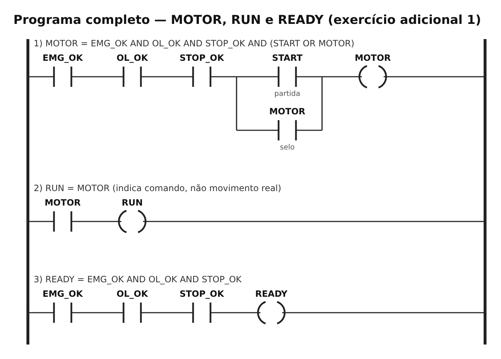
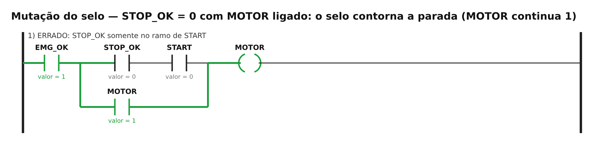
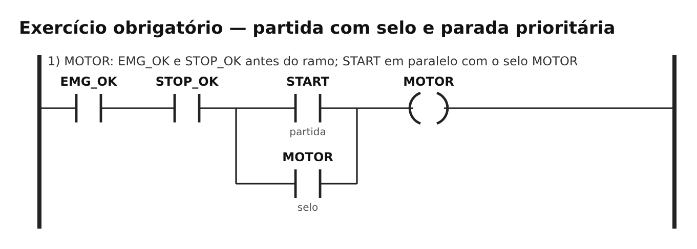
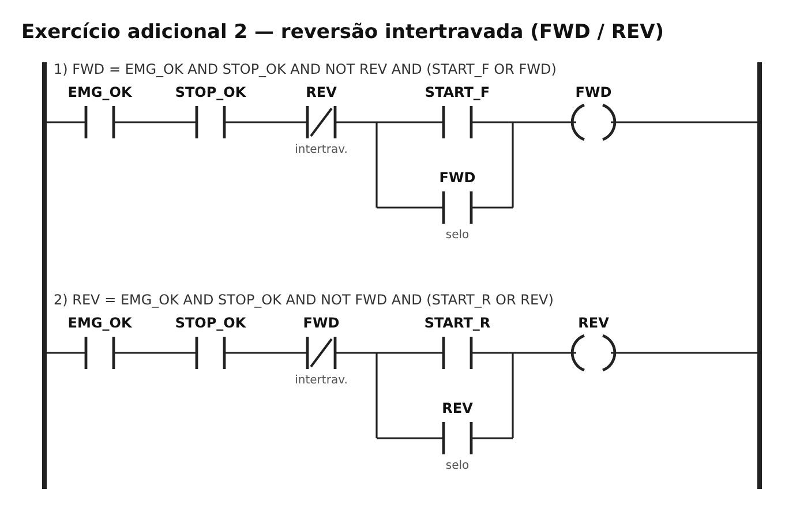
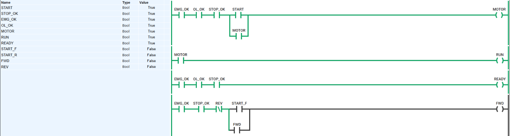
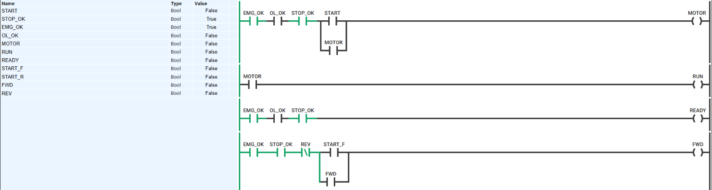

# TP06 — CLP e linguagem Ladder

UC Sistemas Automatizados · Prof. Calvetti · Engenharia de Software — USJT
Murilo Amorim Castro (RA 823135117) · Data: 03/10/2026

**PLC Simulator Online:** [abrir programa](https://app.plcsimulator.online/fhXordNEKE4qjLsazXiW)

## O que fiz

Fiz a partida de um motor que continua ligado depois que solto o botão (selo) e desliga quando aperto parar. Emergência e sobrecarga também desligam. Acrescentei as luzes RUN e READY e uma versão com reversão, para o motor girar para os dois lados sem os dois sentidos ligarem juntos. Depois de qualquer falha, o motor só volta se eu apertar START de novo.

## Arquivos

```
TP06/
├── README.md
├── programa_ladder.md     ← o programa, os nomes e como montar no simulador
├── casos_teste.csv        ← 29 testes
├── diagramas/             ← desenhos dos programas e dos estados
└── capturas/              ← prints do simulador
```

## Nomes usados

START, STOP_OK, EMG_OK, OL_OK, MOTOR, RUN e READY. Na reversão também START_F, START_R, FWD e REV. Tudo que termina em `_OK` vale 1 quando está normal. Detalhes em [`programa_ladder.md`](programa_ladder.md).

## A lógica

```
MOTOR = EMG_OK AND OL_OK AND STOP_OK AND (START OR MOTOR)
RUN   = MOTOR
READY = EMG_OK AND OL_OK AND STOP_OK
```



**Por que o STOP fica antes do selo:** assim ele corta tanto o caminho do START quanto o do próprio MOTOR, que é o que segura o motor ligado. Se o STOP ficasse só junto do START, o selo passaria por fora e o motor não desligaria. Testei esse erro de propósito (caso X01) e foi exatamente o que aconteceu:



## Exercício obrigatório — partida com selo



| ID | Antes | O que fiz | Esperado | Deu | Resultado |
|---|---|---|---|---|---|
| T01 | motor desligado, tudo ok | START=1 | liga | liga | ok |
| T02 | motor ligado | soltei START | continua ligado | continua | ok |
| T03 | motor ligado | STOP_OK=0 | desliga | desliga | ok |
| T04 | motor ligado | EMG_OK=0 | desliga | desliga | ok |
| T05 | emergência acionada | START=1 | não liga | não liga | ok |

Sequência pedida (aperta START, solta, aperta parar): o motor fica **0 → 1 → 1 → 0**.

## Falha e volta

| Teste | Antes | O que fiz | Esperado | Deu | Resultado |
|---|---|---|---|---|---|
| F01 | motor ligado | sobrecarga (OL_OK=0) | desliga | desliga | ok |
| F02 | sobrecarga ativa | START=1 | não liga | não liga | ok |
| F03 | sem START | sobrecarga some | continua desligado | desligado | ok |
| F04 | tudo normal | START de novo | liga | liga | ok |
| F05 | motor ligado | emergência | desliga | desliga | ok |
| F06 | sem START | emergência liberada | continua desligado | desligado | ok |

Seria perigoso o motor voltar sozinho só porque a falha sumiu. Como o desligamento desfaz o selo, sempre precisa de um novo START.

## Adicional 1 — RUN e READY

| Situação | READY | RUN | O que quer dizer |
|---|---|---|---|
| tudo ok e motor parado (I01) | 1 | 0 | pronto para ligar |
| motor ligado (I02) | 1 | 1 | pronto e ligado |
| emergência, sobrecarga ou parada (I03–I05) | 0 | 0 | não pode ligar |

Pode ter READY sem RUN, mas nunca RUN sem READY. O RUN só mostra que o programa mandou ligar. Ele não prova que o motor está girando de verdade.

## Adicional 2 — Reversão



| Caso | O que fiz | Esperado | Deu | Resultado |
|---|---|---|---|---|
| R01 | START_F | gira para frente | FWD=1; REV=0 | ok |
| R02 | START_R com frente ligada | continua para frente | FWD=1; REV=0 | ok |
| R03 | parei e depois START_R | gira para trás | FWD=0; REV=1 | ok |
| R04 | os dois juntos, parado | frente ganha, nunca os dois | FWD=1; REV=0 | ok |
| R05 | emergência | tudo desligado | FWD=0; REV=0 | ok |

Numa máquina de verdade, também precisaria de bloqueio elétrico e mecânico entre os dois contatores, e de um tempo entre um sentido e outro. Só o programa não protege de um contator colado.

## Evidências

- [`casos_teste.csv`](casos_teste.csv): 29 testes, todos repetidos no PLC Simulator Online e todos passaram. O erro do selo (X01) eu montei à parte e confirmei no simulador que o motor não desligava.
- Prints do simulador:

| Partida (START = 1) | Selo (soltei START, motor continua) |
|---|---|
|  |  |
| **Parada (STOP_OK = 0)** | **Sobrecarga (motor e READY desligados)** |
|  |  |

## Active recall

1. **Ciclo do CLP:** lê as entradas, roda o programa e atualiza as saídas, e repete.
2. **Por que ele lê tudo antes:** para usar os mesmos valores durante a volta inteira. Se algo mudar no meio, só é visto na próxima.
3. **Série e paralelo:** série é E, paralelo é OU, contato fechado é NÃO.
4. **STOP antes do selo:** para cortar o START e o selo ao mesmo tempo.
5. **O que o RUN prova:** só que o programa mandou ligar.
6. **Emergência no simulador não é segurança de verdade:** o simulador não testa hardware, fiação nem tempo de parada.

## Limites

Isso testa a lógica, não a segurança. Uma emergência de verdade precisa de componentes próprios (como relé de segurança), projeto pelas normas e testes no equipamento real. O simulador não vê contato colado, fio solto nem quanto tempo o motor leva para parar.
