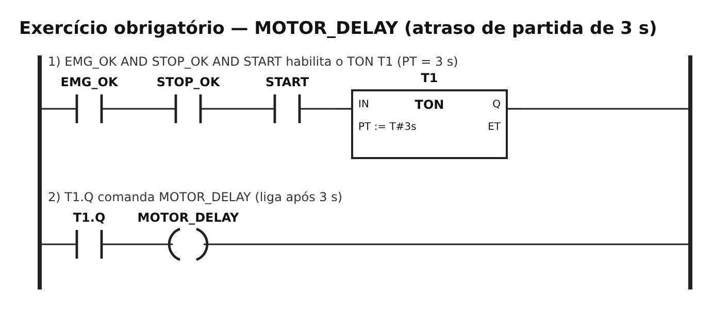
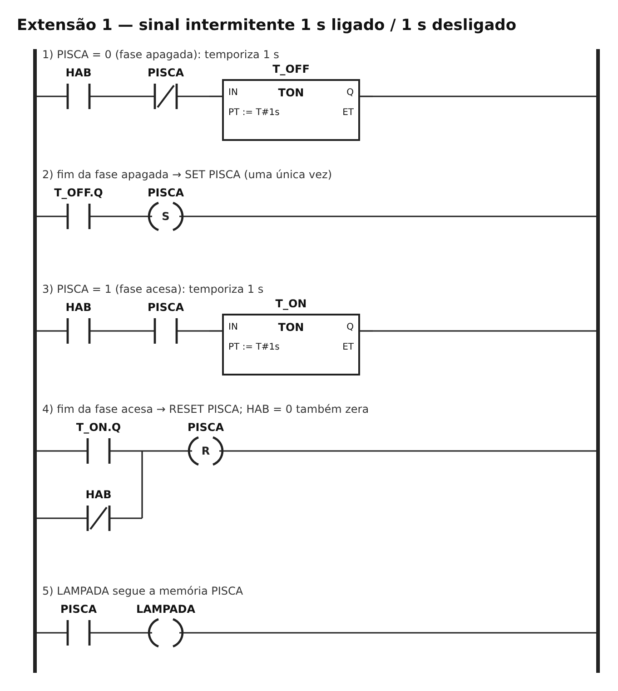
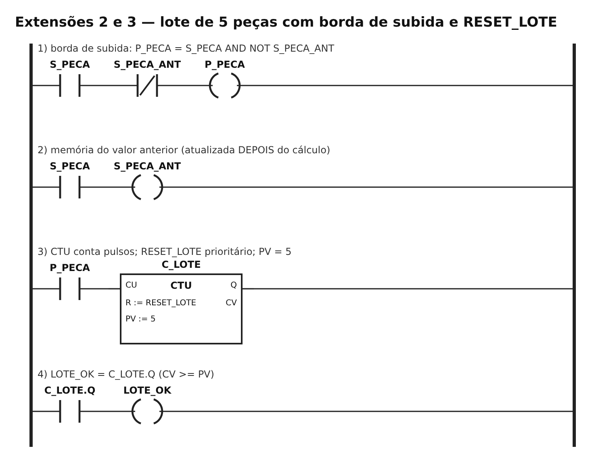
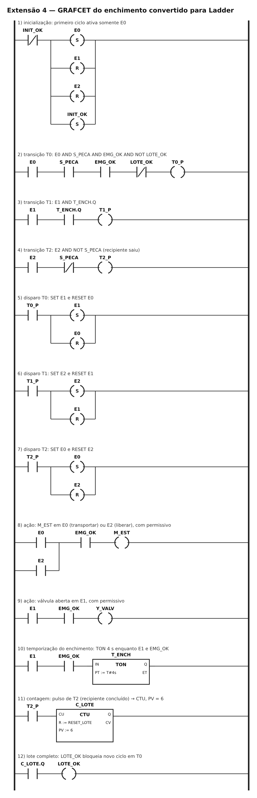

# TP07 — Programação sequencial de CLP (temporização e contagem)

UC Sistemas Automatizados · Prof. Calvetti · Engenharia de Software — USJT
Murilo Amorim Castro (RA 823135117) · Data: 10/10/2026

**PLC Simulator Online:**
- Atraso de partida, pisca e contador: [abrir programa](https://app.plcsimulator.online/QD5ZqWhDshzow981Fwqb)
- Enchimento (GRAFCET em Ladder): [abrir programa](https://app.plcsimulator.online/9jmG5YD3CG7XBAnFEDzW)

## O que fiz

Usei temporizador e contador no Ladder: um motor que só liga 3 s depois do START, uma lâmpada piscando de 1 em 1 segundo, um contador de peças que avisa quando completa o lote e zera no RESET, e uma linha de enchimento que passei do GRAFCET para o Ladder.

## Arquivos

```
TP07/
├── README.md
├── programa_ladder.md          ← programa comentado e decisões
├── casos_teste.csv             ← 25 testes
├── planilha_ciclos.csv         ← passo a passo do enchimento
├── traco_pisca.csv             ← lâmpada a cada 0,5 s
├── tabela_eventos_lote.csv     ← uma contagem por peça
├── diagramas/                  ← os programas desenhados
└── capturas/                   ← prints do simulador
```

## Decisões

Os nomes estão em [`programa_ladder.md`](programa_ladder.md).
- Emergência e parada vêm antes de qualquer temporizador ou movimento.
- Se o RESET e uma peça nova chegarem juntos, o RESET ganha.
- No pisca, cada fase tem seu próprio temporizador, então ele troca uma vez só a cada segundo.

## Obrigatório — motor com atraso de 3 s



O TON conta o tempo enquanto a entrada está ligada (ET) e libera a saída (Q) quando chega em 3 s (PT).

| ID | O que fiz | Esperado | Deu | Resultado |
|---|---|---|---|---|
| T01 | START por 2 s | motor desligado | desligado, ET = 2,05 s | ok |
| T02 | START por 3 s | motor liga | ligado, ET = 3,00 s | ok |
| T03 | parada durante a contagem | zera e não liga | ET = 0, desligado | ok |
| T04 | emergência com motor ligado | desliga | desligou | ok |
| T05 | falha some, sem START | continua desligado | desligado | ok |
| T06 | soltei START em 2,5 s | volta do zero | ET = 0, desligado | ok |
| T07 | 2,9 s e 3,0 s | desligado / ligado | 2,90 s → 0; 3,00 s → 1 | ok |

## Extensão 1 — lâmpada piscando (1 s acesa, 1 s apagada)



| Tempo (s) | 0,5 | 1,0 | 1,5 | 2,0 | 2,5 | 3,0 | 3,5 | 4,0 | 4,5 | 5,0 | 5,5 | 6,0 |
|---|---|---|---|---|---|---|---|---|---|---|---|---|
| Lâmpada | 0 | 1 | 1 | 0 | 0 | 1 | 1 | 0 | 0 | 1 | 1 | 0 |

Em 6 segundos trocou 6 vezes. No simulador as trocas aconteceram em 1,08 / 2,07 / 3,13 / 4,11 / 5,18 / 6,16 s, sempre um pouquinho depois do segundo exato, porque o CLP só vê o fim do tempo na volta seguinte. Olhando no meio de cada segundo, fica igual à tabela.

## Extensão 2 — lote de 5 peças



| Peça | Contou | Total | Lote completo |
|---|---|---|---|
| 1 | 1 vez | 1 | não |
| 2 | 1 vez | 2 | não |
| 3 | 1 vez | 3 | não |
| 4 | 1 vez | 4 | não |
| 5 | 1 vez | 5 | sim |
| sensor parado em 1 por muito tempo | não contou de novo | 1 | — |

O sensor fica ligado por várias voltas do CLP enquanto a peça passa. Se eu contasse o sinal ligado, a mesma peça contaria várias vezes. Por isso conto só o momento em que ele liga, comparando com o valor da volta anterior.

## Extensão 3 — zerar a contagem

| ID | Situação | Esperado | Deu | Resultado |
|---|---|---|---|---|
| Z01 | RESET com 0 | 0 | 0 | ok |
| Z02 | RESET com 3 | 0 | 3 → 0 | ok |
| Z03 | RESET com lote completo | 0 e lote apagado | 5 → 0 | ok |
| Z04 | RESET e peça juntos | 0 (RESET ganha) | 0 | ok |
| Z05 | peça depois do RESET | 1 | 1 | ok |

## Extensão 4 — enchimento, do GRAFCET para o Ladder



| ID | O que precisa acontecer |
|---|---|
| R1 | A esteira leva o recipiente até o sensor. |
| R2 | Quando detecta, a esteira para e começa a encher. |
| R3 | A válvula fica aberta por 4 s. |
| R4 | Depois de encher, a esteira libera o recipiente. |
| R5 | Cada recipiente pronto conta 1 no lote. |
| R6 | Com 6, o lote fica completo e não começa outro. |
| R7 | O RESET zera e libera a produção. |

Passo a passo de um ciclo:

| Momento | Etapa | Esteira | Válvula | Tempo | Lote |
|---|---|---|---|---|---|
| sem recipiente | E0 | ligada | fechada | 0 | 0 |
| recipiente chegou | E1 | parada | aberta | 0,1 s | 0 |
| enchendo | E1 | parada | aberta | 2,1 s | 0 |
| deu 4 s | E1 | parada | aberta | 4,0 s | 0 |
| liberando | E2 | ligada | fechada | 0 | 0 |
| recipiente saiu | E0 | ligada | fechada | 0 | 1 |

| ID | Situação | Esperado | Deu | Resultado |
|---|---|---|---|---|
| G01 | ciclo normal | volta para E0 e conta 1 | E0, lote 1 | ok |
| G02 | duas etapas ativas ao mesmo tempo? | nunca | nunca | ok |
| G03 | emergência enchendo | para esteira e válvula | as duas paradas | ok |
| G04 | sensor travado em 1 | fica esperando em E2 | E2 | ok |
| G05 | tempo ainda não acabou | continua enchendo | E1, válvula aberta | ok |
| G06 | lote com 6 | não começa outro | 6, completo, fica em E0 | ok |
| G07 | RESET | zera e volta a produzir | 0, foi para E1 | ok |
| G08 | sensor piscando durante o enchimento | não pula etapa | E1 | ok |

## Evidências

- Os links dos dois programas estão no topo. O enchimento ficou num programa separado porque usa os mesmos nomes do contador, mas com lote de 6.
- [`casos_teste.csv`](casos_teste.csv): 25 testes, todos repetidos no PLC Simulator Online, todos passaram.
- Prints em `capturas/`:

| Print | O que mostra |
|---|---|
| `ton_antes_pt.png` | contando, ainda em 1,6 s, motor desligado |
| `ton_depois_pt.png` | chegou em 3 s, motor ligado |
| `ton_interrompido.png` | parada durante a contagem, zerou |
| `pisca_lampada_acesa.png` / `pisca_lampada_apagada.png` | as duas fases do pisca |
| `ctu_lote.png` | 5 peças, lote completo |
| `ctu_reset.png` | RESET zerando |
| `sequencia_e1.png` | enchendo, válvula aberta |
| `sequencia_e2_liberando.png` | liberando o recipiente |

## Plano B

Se o simulador não tivesse algum bloco, as alternativas seriam o Virtual Labs PLC (para temporizador e contador) e a `planilha_ciclos.csv` (para mostrar a sequência). Não precisei usar.

## Active recall

1. **TON e TOF:** o TON atrasa para ligar e o TOF atrasa para desligar.
2. **Por que contar o momento e não o sinal:** o sensor fica ligado várias voltas seguidas, e contar o sinal contaria a mesma peça várias vezes.
3. **Por que "maior ou igual" e não "igual":** se a contagem passar do valor, o "igual" deixaria de avisar.
4. **SET e RESET:** o SET liga e mantém, o RESET desliga. Se os dois chegarem juntos, preciso decidir qual ganha.
5. **O que não pode se perder do GRAFCET para o Ladder:** as etapas, a etapa inicial, as condições de passagem, a ordem das trocas e o que cada etapa faz.

## Limites

A simulação mostra a lógica funcionando no simulador. Ela não testa o tempo real de um CLP, a precisão dos temporizadores de verdade, ruído nos sensores nem segurança (a emergência aqui é só lógica, não é uma proteção certificada).
