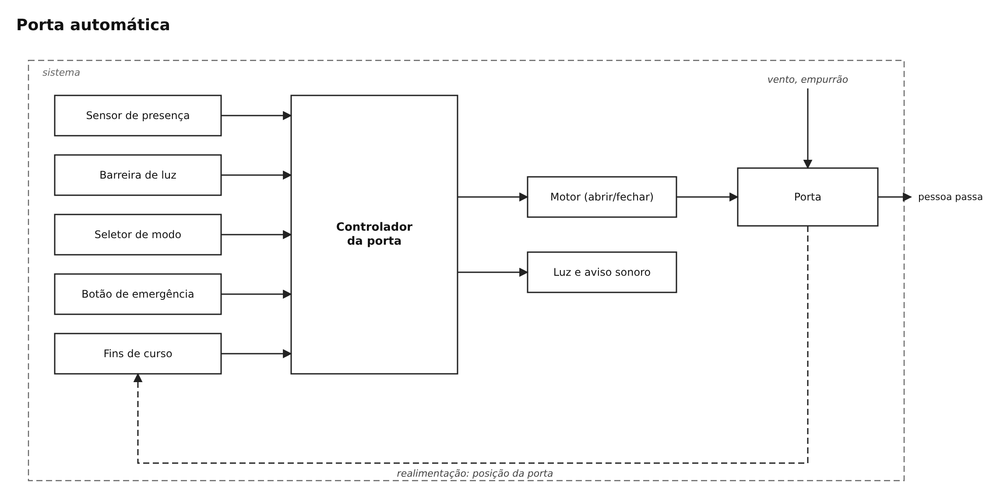
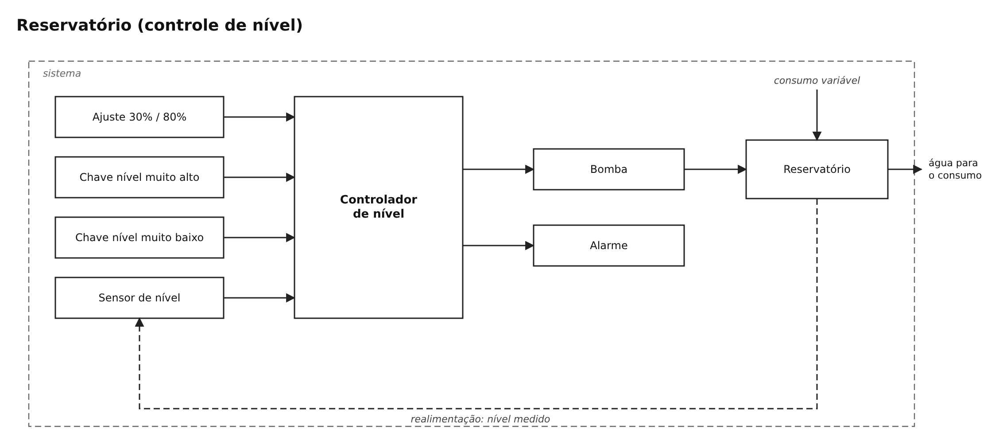
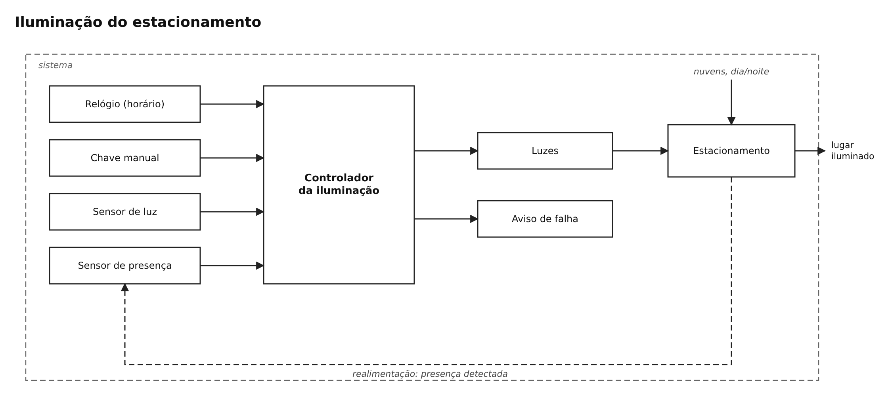
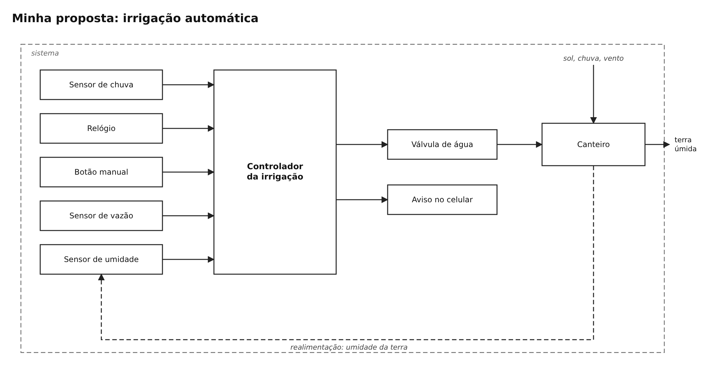

# Semana 1 — Fundamentos dos sistemas automatizados

UC Sistemas Automatizados · Prof. Calvetti · Engenharia de Software — USJT
Murilo Amorim Castro (RA 823135117) · Data: 22/08/2026

## O que tem nesta pasta

| Arquivo | O que é |
|---|---|
| `diagramas.drawio` | arquivo editável do diagrams.net, com uma página por exercício |
| `porta-automatica.png` | exercício obrigatório: porta automática |
| `reservatorio.png` | adicional 1: controle de nível |
| `iluminacao.png` | adicional 2: iluminação do estacionamento |
| `proposta-propria-irrigacao.png` | adicional 3: minha proposta, irrigação automática |

---

## Exercício obrigatório — Porta automática

**Objetivo:** abrir a porta quando alguém chega, fechar depois que a pessoa passa e nunca fechar em cima de ninguém. Em emergência, a porta fica aberta para servir de rota de fuga.

**O que faz parte do sistema:** sensores de presença, barreira de luz, fins de curso, seletor de modo, botão de emergência, controlador, motor e a própria porta. Ficam de fora as pessoas, a central de incêndio, a rede elétrica e o vento.

**Classificação:** é automático no uso normal, porque ele mesmo percebe a pessoa e abre. Escolher o modo (automático, sempre aberta ou travada) e rearmar depois de uma emergência continuam sendo decisões de uma pessoa.

### Entradas, decisão e saídas

| Tipo | Elemento | O que informa ou faz |
|---|---|---|
| Entrada | sensor de presença | tem alguém chegando |
| Entrada | barreira de luz | tem algo no caminho |
| Entrada | seletor de modo | automático / aberta / travada |
| Entrada | emergência ou alarme de incêndio | comando que passa na frente de tudo |
| Entrada | fins de curso | se a porta está realmente aberta ou fechada |
| Saída | motor | abrir, fechar ou parar |
| Saída | LED e aviso sonoro | mostrar falha ou emergência |

**Regras que defini:**
1. Modo automático e alguém chegando → abre.
2. Fica aberta enquanto houver alguém ou a barreira estiver cortada.
3. Fecha depois de 5 s sem ninguém.
4. Se aparecer algo enquanto fecha → para e abre de novo.
5. Emergência → abre e fica aberta, acima de qualquer outra regra.
6. Se o fim de curso não confirmar em 8 s, ou um sensor der sinal estranho → considera falha.

### Realimentação, perturbação e falha

- **Realimentação:** os fins de curso dizem onde a porta realmente está. Só considero "aberta" ou "fechada" quando eles confirmam.
- **Perturbações:** vento, alguém empurrando a porta, sujeira no trilho.
- **Falha principal:** sensor de presença ou barreira travado ou com sinal inválido.

### O que acontece quando algo dá errado

- Sensor com problema → a porta não fecha sozinha, fica aberta e avisa.
- Obstáculo ao fechar → para e reabre.
- Emergência → abre tudo e só volta ao normal com rearme manual.
- Motor não responde → desliga o motor e alarma.
- Falta de energia → a porta fica solta para abrir na mão.

### Testes

Testei o modelo cenário por cenário:

| Cenário | Entrada | Esperado | O que o modelo fez | Resultado |
|---|---|---|---|---|
| Pessoa chegando | presença no modo automático | abrir | regra 1, abre | ok |
| Passou | 5 s sem ninguém | fechar | regra 3, fecha | ok |
| Obstáculo | barreira cortada ao fechar | parar e reabrir | regra 4 | ok |
| Sensor com falha | sinal inválido da barreira | não fechar sozinha | fica aberta e alarma | ok |
| Emergência | botão acionado | ficar segura | regra 5, abre e mantém | ok |
| Motor travado | abrir sem fim de curso em 8 s | parar e avisar | regra 6 | ok |

---

## Adicional 1 — Reservatório

- **Objetivo:** manter o nível entre 30 % e 80 %, sem transbordar e sem a bomba rodar a seco.
- **Tipo:** automático em malha fechada, porque o nível medido é o que liga e desliga a bomba.
- **Peças:** reservatório, transmissor de nível, chaves de nível muito alto e muito baixo, controlador, bomba. O consumo variável é a perturbação.
- **Por que dois limites:** liga abaixo de 30 % e desliga em 80 %. Com um limite só, a bomba ficaria ligando e desligando o tempo todo.
- **Falhas:** sensor travado, sinal fora da faixa, bomba sem resposta, nível muito alto.
- **Estado seguro:** nível muito alto ou sensor inválido → bomba desligada e alarme, sem religar sozinha.

| Caso | Nível | Bomba antes | Esperado | Resultado |
|---|---|---|---|---|
| R1 | 25 % | desligada | liga | ok |
| R2 | 50 % | ligada | continua ligada | ok |
| R3 | 80 % | ligada | desliga | ok |
| R4 | 50 % | desligada | continua desligada | ok |
| R5 | chave de nível muito alto ativa, sensor marcando 60 % | ligada | desliga e alarma (os dois não batem) | ok |
| R6 | sensor marcando 120 % | qualquer | desliga e alarma falha | ok |

## Adicional 2 — Iluminação do estacionamento

- **Entradas:** está escuro, tem presença, está no horário, chave manual.
- **Regra no automático:** `LUZ = ESCURO AND PRESENÇA AND HORÁRIO`, e a luz fica mais 3 min depois da última presença.
- **Manual:** ligar ou desligar na chave vale mais que o automático.
- **Falha de sensor:** dentro do horário, se a fotocélula ou o sensor de presença falhar, as luzes ficam acesas e aparece um aviso. Prefiro gastar energia a deixar alguém no escuro.

| Caso | Escuro | Presença | Horário | Modo | Esperado | Resultado |
|---|---|---|---|---|---|---|
| L1 | 1 | 1 | 1 | auto | acende | ok |
| L2 | 0 | 1 | 1 | auto | apagada (dia) | ok |
| L3 | 1 | 0 | 1 | auto | apaga 3 min depois | ok |
| L4 | 1 | 1 | 0 | auto | apagada (fora do horário) | ok |
| L5 | qualquer | qualquer | qualquer | manual ligado | acende | ok |
| L6 | fotocélula com falha | 1 | 1 | auto | acende e avisa | ok |

## Adicional 3 — Minha proposta: irrigação automática

- **Para quê e para quem:** manter a terra úmida no jardim ou horta de um condomínio, para o morador ou o zelador não precisar lembrar de regar.
- **Tipo:** automático, com botão manual. Os horários e limites dá para ajustar, e a umidade do solo fecha a malha.
- **Entradas e saídas:** umidade, chuva, relógio, botão e vazão entram no controlador, que comanda a válvula e um aviso.
- **Perturbações:** sol, chuva, vento, pressão da água variando.
- **Riscos e estado seguro:** válvula presa aberta, sensor travado, falta d'água. Por isso a válvula é normalmente fechada, cada rega dura no máximo 20 min e uma válvula geral fecha se detectar vazamento.
- **Melhoria:** olhar a previsão do tempo e pular a rega se for chover nas próximas 12 h. O sensor de chuva continua lá caso a internet caia.

---

## Riscos da porta automática

| Falha | O que causa | Como percebo | O que o sistema faz |
|---|---|---|---|
| Sensor de presença travado | porta não abre ou não fecha | sinal parado tempo demais | não fecha sozinha, fica aberta e avisa |
| Barreira com defeito | pode fechar em alguém | autoteste antes de fechar | não fecha e chama manutenção |
| Falta de energia | sistema para | sem alimentação | porta solta para abrir na mão |
| Comando de fechar errado | fechar com alguém passando | barreira livre e sem presença são obrigatórias | ignora o comando |
| Motor não responde | porta não se mexe | fim de curso não chega em 8 s | para o motor e alarma |

## Checklist

- [x] O que faz parte do sistema está dentro do retângulo tracejado.
- [x] Entradas à esquerda, controlador no meio, saídas e planta à direita.
- [x] As decisões são regras que dá para testar.
- [x] Tem realimentação onde precisa (linha tracejada de volta para o sensor).
- [x] A perturbação aparece chegando na planta.
- [x] Falhas e estado seguro estão tratados neste README.
- [x] Dá para entender o diagrama só lendo este README.

## Active recall

1. **Manual, semiautomático e automático:** a diferença é quem decide e quem executa. No manual eu decido e faço (abrir um registro). No semiautomático eu autorizo e a máquina faz o resto (a lavadora só começa quando aperto o botão). No automático ele percebe, decide e age sozinho (o termostato da geladeira).
2. **Quando precisa de realimentação:** quando alguma coisa de fora pode atrapalhar o resultado. O ar-condicionado precisa medir a temperatura porque a quantidade de gente na sala muda.
3. **Sensor e atuador:** o sensor transforma algo físico em informação (o termômetro do forno). O atuador transforma um comando em ação (a resistência do forno).
4. **Falha segura:** quando algo dá errado, o sistema vai para a situação que causa menos dano, que nem sempre é desligar tudo. O elevador sem energia trava o freio em vez de soltar a cabine.
5. **Software com consequência física:** um erro no código vira uma ação no mundo real. Trocar `>=` por `>` numa irrigação pode deixar a válvula aberta e alagar o jardim.

## Limitações

São modelos para entender o funcionamento. Não dimensionam componentes e não substituem uma análise de risco feita pelas normas de verdade.
