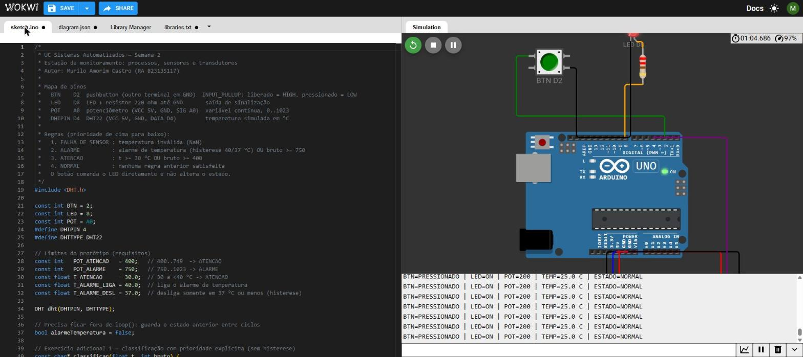

# Semana 2 — Processos, sensores e transdutores

UC Sistemas Automatizados · Prof. Calvetti · Engenharia de Software — USJT
Murilo Amorim Castro (RA 823135117) · Data: 29/08/2026

**Projeto no Wokwi:** [abrir simulação](https://wokwi.com/projects/478265060150017025)

## O que fiz

Montei no Wokwi uma estação de monitoramento com um botão, um potenciômetro, um sensor de temperatura DHT22 e um LED. O programa olha as leituras e diz se está tudo **NORMAL**, se precisa de **ATENÇÃO**, se é **ALARME** ou se o sensor deu **FALHA**. Tudo aparece no Monitor Serial.

## Arquivos

```
semana-02-sensores/
├── README.md
├── sketch.ino          ← programa final
├── diagram.json        ← circuito do Wokwi
├── libraries.txt       ← bibliotecas
├── etapas/             ← versões intermediárias (1 a 5)
├── evidencias/         ← prints do Wokwi
└── testes/
    └── casos-de-teste.md
```

## Componente do Wokwi × equivalente na indústria

| O que mede | No Wokwi | Pino | Na indústria seria |
|---|---|---|---|
| presença / posição | botão | D2 | fim de curso, sensor indutivo |
| pressão (simulada) | potenciômetro | A0 | transmissor 4–20 mA |
| temperatura | DHT22 | D4 | Pt100 ou termopar com transmissor |
| sinalização | LED + resistor 220 Ω | D8 | sinaleiro ou relé |
| controlador | Arduino Uno | — | CLP |

## Ligações

| Componente | Pino | Como liguei |
|---|---|---|
| Botão | D2 | outro lado no GND, usando o pull-up interno |
| LED | D8 | D8 → resistor 220 Ω → LED → GND |
| Potenciômetro | A0 | pontas em 5 V e GND, meio no A0 |
| DHT22 | D4 | VCC no 5 V, GND no GND, DATA no D4 |

Com o pull-up interno a lógica fica invertida: solto lê HIGH e apertado lê LOW. No código eu corrigi isso com `detectado = digitalRead(BTN) == LOW`.

## Como o programa decide

A ordem importa: a primeira regra que for verdadeira define o estado.

| Ordem | Estado | Quando |
|---|---|---|
| 1 | FALHA DE SENSOR | a temperatura veio inválida |
| 2 | ALARME | temperatura ≥ 40 °C ou potenciômetro ≥ 750 |
| 3 | ATENÇÃO | temperatura ≥ 30 °C ou potenciômetro ≥ 400 |
| 4 | NORMAL | nenhuma das anteriores |

| | Normal | Atenção | Alarme |
|---|---|---|---|
| Potenciômetro | 0–399 | 400–749 | 750–1023 |
| Temperatura | < 30 °C | 30 a 39,9 °C | ≥ 40 °C (só sai abaixo de 37 °C) |

Coloquei a falha primeiro porque, se o sensor não está funcionando, nada do que ele diz pode ser levado em conta.

## Para rodar

1. No Wokwi, crie um projeto novo com Arduino Uno.
2. Cole o `diagram.json` na aba de mesmo nome. O circuito já aparece montado.
3. Cole o `sketch.ino`.
4. Adicione a biblioteca **DHT sensor library** (Adafruit).
5. Rode e abra o Monitor Serial. A cada segundo aparece algo como:
   `BTN=LIBERADO | LED=OFF | POT=200 | TEMP=25.0 C | ESTADO=NORMAL`
6. Clique no potenciômetro ou no DHT22 durante a simulação para mudar os valores.

## Testes

Rodei todos no Wokwi. Os prints estão em [`evidencias/testes-integrados.png`](evidencias/testes-integrados.png) e a lista completa em [`testes/casos-de-teste.md`](testes/casos-de-teste.md).



| Caso | Pot. | Temp. | Botão | Esperado | Deu | Resultado |
|---|---|---|---|---|---|---|
| T1 | 200 | 25 °C | solto | NORMAL, LED apagado | NORMAL, LED apagado | ok |
| T2 | 500 | 25 °C | solto | ATENÇÃO | ATENCAO | ok |
| T3 | 800 | 25 °C | solto | ALARME | ALARME | ok |
| T4 | 200 | 35 °C | solto | ATENÇÃO | ATENCAO | ok |
| T5 | 200 | 45 °C | solto | ALARME | ALARME | ok |
| T6 | 200 | 25 °C | apertado | NORMAL, LED aceso | NORMAL, LED aceso | ok |
| T7 | — | inválida | solto | FALHA DE SENSOR | FALHA DE SENSOR | ok |

## Exercícios adicionais

**1. Prioridade dos alarmes.** Coloquei a decisão numa função, `classificar(t, bruto)`. A ordem dos `if` é a prioridade: FALHA, depois ALARME, depois ATENÇÃO, depois NORMAL. O caso P5 (potenciômetro em 900 e temperatura inválida) mostra que falha de sensor não vira alarme nem normal.

**2. Histerese.** Sem ela, uma temperatura oscilando perto de 40 °C ficaria trocando entre ATENÇÃO e ALARME a cada leitura. Agora o alarme liga em 40 °C e só desliga quando cai para 37 °C. Testei a sequência H1–H8 e funcionou. No H6 o resultado é ATENÇÃO, e não NORMAL, porque a temperatura ainda está acima de 30 °C.

**3. Escolhendo instrumentos de verdade.** Pensei numa câmara térmica com porta, linha de pressão e temperatura interna.

| No Wokwi | O que mede | O que eu usaria | Faixa | Sinal | Por quê |
|---|---|---|---|---|---|
| botão | porta fechada | fim de curso ou sensor indutivo | 2 estados | 24 V | simples e resistente |
| potenciômetro | pressão | transmissor de pressão | 0–10 bar | 4–20 mA | aguenta distância e ruído, e 4 mA mostra que o fio está ok |
| DHT22 | temperatura | Pt100 com transmissor | 0–150 °C | 4–20 mA | estável e cobre a faixa |

| Instrumento | Falha que dá para perceber | Falha que passa despercebida |
|---|---|---|
| Sensor da porta | fio rompido | sensor torto, mas ainda acionando |
| Transmissor de pressão | corrente abaixo de 3,6 mA | erro pequeno que parece normal |
| Pt100 | sensor rompido | erro de calibração pequeno |

## Limitações

| O Wokwi mostra | O Wokwi não mostra |
|---|---|
| leitura das entradas | tempo de resposta e tolerância reais |
| lógica e prioridade | ruído elétrico e aterramento |
| saída no Monitor Serial | montagem, cabos e proteção |
| testes nos limites | calibração e segurança de verdade |

A simulação prova que a lógica funciona, mas não que os instrumentos reais seriam adequados.

## Active recall

1. **Sensor, transdutor e transmissor:** o sensor reage ao fenômeno, o transdutor transforma um tipo de energia em outro (temperatura em resistência) e o transmissor padroniza o sinal para mandar longe (4–20 mA). Um Pt100 com transmissor faz os três papéis.
2. **Digital não quer dizer preciso:** o DHT22 entrega um número digital, mas tem erro de ±0,5 °C. Digital é só a forma do sinal.
3. **Resolução e repetibilidade:** resolução é o menor passo que ele mostra (0,1 °C). Repetibilidade é se ele mostra o mesmo valor quando mede a mesma coisa várias vezes.
4. **Detectar metal:** sensor indutivo. Funciona sem encostar e aguenta poeira e óleo.
5. **O que o Wokwi não valida:** ruído, aterramento, calibração e segurança.
