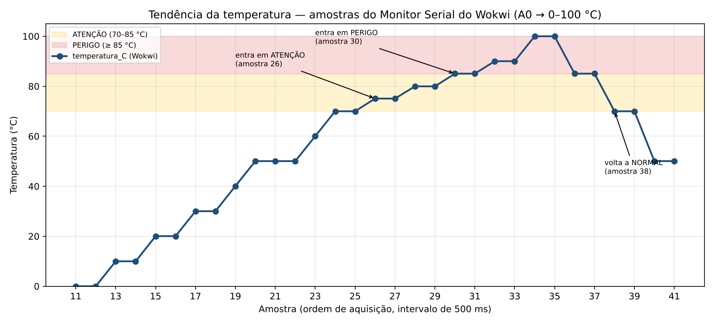
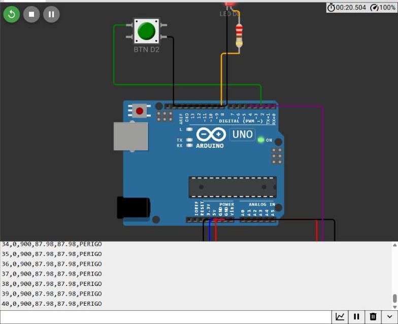

# Semana 3 — Sinais analógicos e digitais

UC Sistemas Automatizados · Prof. Calvetti · Engenharia de Software — USJT
Murilo Amorim Castro (RA 823135117) · Data: 05/09/2026

**Projeto no Wokwi:** [abrir simulação](https://wokwi.com/projects/478265201686832129)
**Planilha:** [abrir no Google Planilhas](https://docs.google.com/spreadsheets/d/1bcn2hpSh2jtQlXyfdjZ9F36qYAef5_c3hgn3Jm9tSNc/edit?usp=sharing)

## O que fiz

Peguei a estação da Semana 2 e fiz ela ler o potenciômetro, converter o valor para porcentagem e depois para temperatura (0 a 100 °C), decidir o estado (NORMAL, ATENÇÃO, PERIGO ou FALHA) e imprimir tudo em formato CSV. Depois conferi as contas numa planilha e fiz um gráfico.

## Arquivos

```
semana-03-sinais/
├── README.md
├── sketch.ino                 ← programa final
├── diagram.json               ← mesmo circuito da Semana 2
├── libraries.txt
├── etapas/
│   ├── 01-aquisicao-csv.ino   ← só lê botão e potenciômetro
│   ├── 02-escalonamento.ino   ← converte para % e °C
│   └── 03-media-movel.ino     ← filtro (adicional 1)
├── planilha/
│   ├── escalonamento.xlsx
│   ├── amostras_monitor_serial.csv
│   ├── media_movel_serial.csv
│   └── grafico-tendencia.png
├── testes/casos-de-teste.md
└── evidencias/
```

## Que tipo de sinal é cada coisa

| Elemento | Entra ou sai | Tipo |
|---|---|---|
| Botão (D2) | entra | liga/desliga |
| Potenciômetro (A0) | entra | analógico, vira número no conversor |
| DHT22 (D4) | entra | digital, já manda o número pronto |
| LED (D8) | sai | liga/desliga |
| Porcentagem | calculada | não é sinal físico, é conta |

| Nome | Onde | Faixa | Para quê |
|---|---|---|---|
| POT_BRUTO | A0 | 0–1023 | leitura crua |
| BTN_COMANDO | D2 | HIGH/LOW | botão |
| LED_ALARME | D8 | ligado/desligado | avisar PERIGO |
| NIVEL_PCT | memória | 0–100 % | decidir o estado |
| TEMP_C | memória | 0–100 °C | valor em temperatura |

## As contas

- O conversor do Arduino tem 10 bits, então vai de 0 a 1023. Cada passo vale uns 4,88 mV.
- Porcentagem: `pct = 100.0 * bruto / 1023.0`. O `.0` é para não fazer divisão inteira.
- Como a faixa é 0 a 100 °C, a temperatura dá o mesmo número da porcentagem.
- Na planilha também calculei como ficaria em 4–20 mA (`4 + 16·p/100`) e em 0–10 V (`10·p/100`).

| Bruto | % | °C | mA | V |
|---|---|---|---|---|
| 0 | 0,000 | 0,000 | 4,000 | 0,000 |
| 512 | 50,049 | 50,049 | 12,008 | 5,005 |
| 1023 | 100,000 | 100,000 | 20,000 | 10,000 |

O 512 não dá 50 % certinho porque a escala vai até 1023, e 512/1023 é um pouco mais que a metade.

## Estados

| Ordem | Estado | Quando |
|---|---|---|
| 1 | FALHA | fora de 0–100 % |
| 2 | PERIGO | ≥ 85 % (LED acende) |
| 3 | ATENÇÃO | ≥ 70 % |
| 4 | NORMAL | abaixo de 70 % |

Primeiro vejo se a leitura faz sentido, depois vou do mais grave para o menos grave.

## Para rodar

1. No Wokwi, abra o projeto (link no topo) e rode. O Monitor Serial mostra `amostra,botao,bruto,pct,tempC,estado` a cada 0,5 s.
2. Gire o potenciômetro devagar até o fim e volte.
3. Na planilha, as colunas A, B e H são as linhas copiadas do Monitor Serial. O resto é fórmula. A coluna `confere` compara o estado da planilha com o do Arduino, e as 31 amostras bateram.

| Aba | O que tem |
|---|---|
| `aquisicao` | amostras, contas, conferência e gráfico com as linhas de 70 e 85 °C |
| `fronteiras` | testes em −1; 0; 69,99; 70; 84,99; 85; 100 e 100,01 % |
| `calculo_inverso` | adicional 2: de temperatura para mA e V |
| `diagnostico_4-20mA` | adicional 3: correntes fora da faixa |
| `media_movel` | adicional 1: leitura crua × filtrada |

Fórmula do estado: `=SE(OU(C2<0;C2>100);"FALHA";SE(C2>=85;"PERIGO";SE(C2>=70;"ATENÇÃO";"NORMAL")))`

## Gráfico



Girei o potenciômetro do zero até o máximo e voltei. A temperatura subiu junto, entrou em ATENÇÃO na amostra 26 (75 °C) e em PERIGO na 30 (85 °C), quando o LED acendeu. Chegou a 100 °C e, na volta, saiu do alarme na amostra 38 (69,99 °C). Nas amostras 20 a 22 apertei o botão, e o estado não mudou, como esperado.



## Testes

Lista completa em [`testes/casos-de-teste.md`](testes/casos-de-teste.md). Estes peguei direto do Monitor Serial:

| Caso | O que fiz | Esperado | Saída do Monitor Serial | Resultado |
|---|---|---|---|---|
| A1 | botão solto, pot no mínimo | 0 e perto de 0 | `14,0,0,0.00,0.00,NORMAL` | ok |
| A2 | botão apertado, pot no mínimo | 1 e perto de 0 | `17,1,0,0.00,0.00,NORMAL` | ok |
| A3 | botão solto, pot no meio | 0 e perto de 512 | `19,0,512,50.05,50.05,NORMAL` | ok |
| A4 | botão solto, pot no máximo | 0 e perto de 1023 | `22,0,1023,100.00,100.00,PERIGO` | ok |
| — | pot em 717 (limite) | ATENÇÃO | `24,0,717,70.09,70.09,ATENCAO` | ok |
| F1–F8 | −1 a 100,01 % na planilha | estado certo em cada limite | todos bateram | ok |

## Exercícios adicionais

1. **Filtro de média móvel (5 amostras):** coloquei um pico falso de 1000 no meio de leituras de ~500. Ele afetou exatamente 5 saídas (foram para ~600) e depois sumiu. O problema é que o filtro também atrasa mudanças reais em 5 amostras (2,5 s), e num alarme isso pode ser perigoso.
2. **Cálculo inverso:** 0, 25, 50, 75 e 100 °C viram 4, 8, 12, 16 e 20 mA (e 0 a 10 V). Fazendo a conta de volta, chega na mesma temperatura.
3. **Diagnóstico:** corrente abaixo de 4 mA ou acima de 20 mA é falha no fio ou no instrumento. Por isso verifico isso antes de calcular o estado: 3,2 mA é falha, não "−5 %". Assim um instrumento com defeito nunca aparece como "tudo normal".

## Conclusão

Funcionou a leitura do botão e do potenciômetro, a conversão (0, 512 e 1023 bateram), a equivalência entre 4–20 mA e 0–10 V, os estados nos limites, o gráfico e o filtro.

A simulação não mostra ruído elétrico, aterramento, precisão real do instrumento nem o comportamento de um transmissor de verdade. Os valores fora da faixa testei só na planilha, porque o potenciômetro do Wokwi só vai de 0 a 1023.

## Active recall

1. **Contínuo, analógico e digital:** contínuo é a variável em si, que pode ter qualquer valor no meio. Analógico é um sinal elétrico proporcional (0 a 5 V). Digital é o valor já virado número (0 a 1023).
2. **10 bits:** 1024 valores, de 0 a 1023. Com 5 V, cada passo vale uns 4,88 mV.
3. **Zero vivo:** no 4–20 mA, o zero é 4 mA e não 0 mA. Se chegar 0 mA, sei que o fio rompeu.
4. **Escalonamento ida e volta:** é a mesma regra de três nos dois sentidos. 12 mA dá 50 °C e 50 °C dá 12 mA.
5. **Quando filtrar é ruim:** quando o filtro atrasa um alarme ou esconde um problema real.
