# Semana 04 — Sistemas discretos e lógica combinacional

UC Sistemas Automatizados · Prof. Calvetti · Engenharia de Software — USJT
Murilo Amorim Castro (RA 823135117) · Data: 12/09/2026

**CircuitVerse:** [abrir circuitos](https://circuitverse.org/users/474051/projects/2086090)
**PLC Simulator Online:** [abrir Ladder](https://app.plcsimulator.online/WFvPubRUHaYws46tXpib)

## Arquivos

```
semana-04-logica/
├── README.md
├── casos_teste.csv     ← 57 testes com esperado e obtido
├── circuitos/          ← desenhos dos circuitos de portas
├── ladder/             ← desenhos dos programas Ladder
└── capturas/           ← prints dos simuladores
```

## Combinados

Usei 1 como verdadeiro e 0 como falso.

| Variável | 0 | 1 |
|---|---|---|
| S — START | botão solto | botão apertado |
| G — proteção | aberta | fechada |
| E — emergência | não acionada | acionada |
| M — motor | desligado | liberado |
| T / P | temperatura / pressão normal | alta |
| MNT | sem manutenção | em manutenção |
| CA / CB | sem comando | comando do motor A / B |

Como E = 1 significa emergência acionada, ela entra como `NOT E` em tudo que liga motor.

## Expressões

| Saída | Expressão | Em palavras |
|---|---|---|
| M | `S AND G AND NOT E` | só liga com START, proteção fechada e sem emergência |
| A | `(T OR P) AND NOT MNT` | alarme por temperatura ou pressão, menos em manutenção |
| MA, MB | `CA AND NOT MB AND NOT E` · `CB AND NOT MA AND NOT E` | os dois motores nunca juntos |
| AL_E | `E` | alarme de emergência |
| D | `A XOR B` | os dois sensores discordam |
| V | `D AND G AND NOT F` | ventilação liberada |
| MA_seguro, MB_seguro | `CA AND NOT E` · `CB AND NOT CA AND NOT E` | se pedir os dois, A ganha |

## Exercícios resolvidos

- **Alarme:** com T=0, P=1 e MNT=0 o alarme toca. Com T=1, P=0 e MNT=1 ele fica quieto. Desligar o alarme em manutenção só faz sentido se isso for avaliado como seguro.
- **Simplificação:** `(A AND B) OR (A AND NOT B)` dá só `A`, ou seja, B não muda nada. Se era para B importar, o requisito está errado.
- **Expressão errada:** `M = (S AND G) OR NOT E` liga o motor com S=0, G=0 e E=0, sem ninguém pedir e com a proteção aberta. Por isso testo a tabela inteira e não só o caso em que está tudo certo.

## 1. Portas básicas e partida (CircuitVerse)

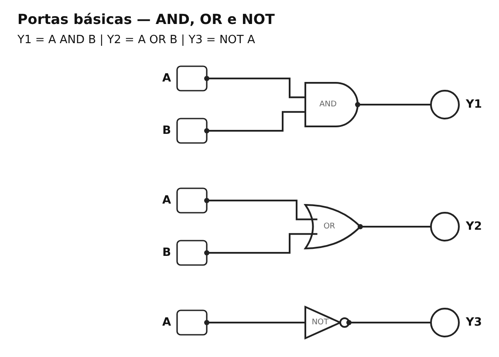
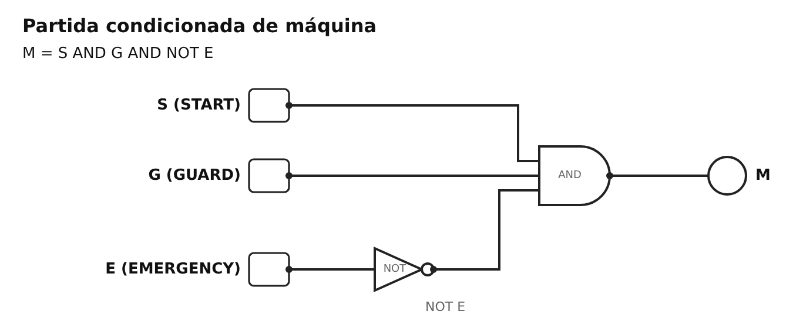

| Porta | A | B | Esperado | Deu | Resultado |
|---|---|---|---|---|---|
| AND | 0 | 0 | 0 | 0 | ok |
| AND | 0 | 1 | 0 | 0 | ok |
| AND | 1 | 0 | 0 | 0 | ok |
| AND | 1 | 1 | 1 | 1 | ok |
| OR | 0 | 0 | 0 | 0 | ok |
| OR | 0 | 1 | 1 | 1 | ok |
| OR | 1 | 0 | 1 | 1 | ok |
| OR | 1 | 1 | 1 | 1 | ok |
| NOT | 0 | – | 1 | 1 | ok |
| NOT | 1 | – | 0 | 0 | ok |

### Partida — as 8 combinações

| ID | S | G | E | M esperado | M deu | Resultado |
|---|---:|---:|---:|---:|---:|---|
| P01 | 0 | 0 | 0 | 0 | 0 | ok |
| P02 | 0 | 0 | 1 | 0 | 0 | ok |
| P03 | 0 | 1 | 0 | 0 | 0 | ok |
| P04 | 0 | 1 | 1 | 0 | 0 | ok |
| P05 | 1 | 0 | 0 | 0 | 0 | ok |
| P06 | 1 | 0 | 1 | 0 | 0 | ok |
| P07 | 1 | 1 | 0 | 1 | 1 | ok |
| P08 | 1 | 1 | 1 | 0 | 0 | ok |

Só a combinação **110** liga o motor.

## 2. Alarme

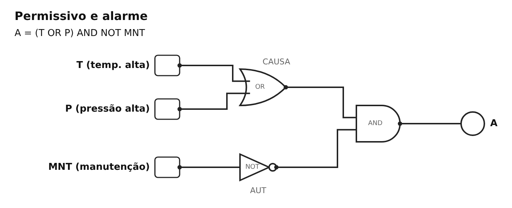

| T | P | MNT | A esperado | A deu | Resultado |
|---|---|---|---|---|---|
| 0 | 0 | 0 | 0 | 0 | ok |
| 0 | 1 | 0 | 1 | 1 | ok |
| 1 | 0 | 0 | 1 | 1 | ok |
| 1 | 1 | 0 | 1 | 1 | ok |
| 0 | 0 | 1 | 0 | 0 | ok |
| 0 | 1 | 1 | 0 | 0 | ok |
| 1 | 0 | 1 | 0 | 0 | ok |
| 1 | 1 | 1 | 0 | 0 | ok |

## 3. Intertravamento e emergência

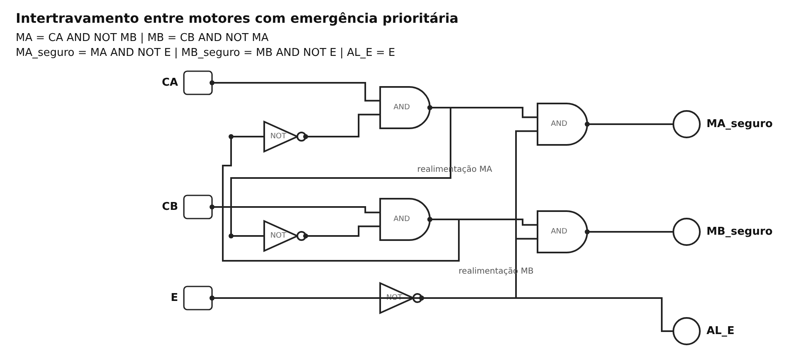

Aqui um motor bloqueia o outro, então o resultado depende de quem já estava ligado. Para o caso de pedir os dois ao mesmo tempo a partir do zero, decidi que **A ganha**. A emergência desliga tudo e acende o alarme.

| Caso | CA | CB | Antes | Esperado | Deu | Resultado |
|---|---|---|---|---|---|---|
| I1 | 0 | 0 | tudo desligado | nada liga | MA=0; MB=0 | ok |
| I2 | 1 | 0 | tudo desligado | só A | MA=1; MB=0 | ok |
| I3 | 0 | 1 | tudo desligado | só B | MA=0; MB=1 | ok |
| I4 | 1 | 1 | A ligado | A continua | MA=1; MB=0 | ok |
| I5 | 1 | 1 | B ligado | B continua | MA=0; MB=1 | ok |
| I6 | 1 | 1 | tudo desligado | A ganha | MA=1; MB=0 | ok |

| Caso | Antes | O que fiz | Esperado | Deu | Resultado |
|---|---|---|---|---|---|
| E01 | motores desligados | E=1 | alarme aceso | MA=0; MB=0; AL_E=1 | ok |
| E02 | A ligado | E=1 | A desliga | MA=0; MB=0; AL_E=1 | ok |
| E03 | B ligado | E=1 | B desliga | MA=0; MB=0; AL_E=1 | ok |
| E04 | E=1 | pedi A e B | nada liga | MA=0; MB=0; AL_E=1 | ok |
| E05 | E volta a 0 | não pedi nada | não religa sozinho | MA=0; MB=0 | ok |

Em nenhum caso os dois motores ligaram juntos. Como ainda não tem memória nesta semana, o rearme de verdade fica para a Semana 6.

## 4. O mesmo em Ladder (PLC Simulator Online)

| | AND | OR | NOT |
|---|---|---|---|
| CircuitVerse | porta AND | porta OR | porta NOT |
| Ladder | contatos em série | contatos em paralelo | contato fechado `|/|` |

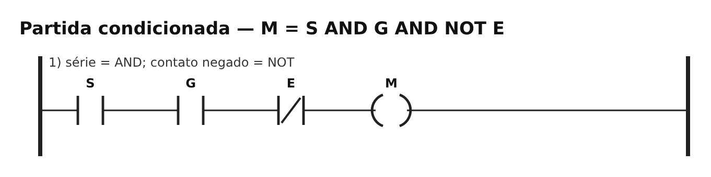

Coloquei todos os circuitos num programa só, com 12 linhas. Para os nomes não se repetirem, as portas básicas usam `IA`, `IB` → `Y1`, `Y2`, `Y3`, o XOR usa `SA`, `SB` → `D` e a ventilação usa `VD`, `VG`, `VF` → `V`. Repeti os 57 testes no simulador e todos deram igual.

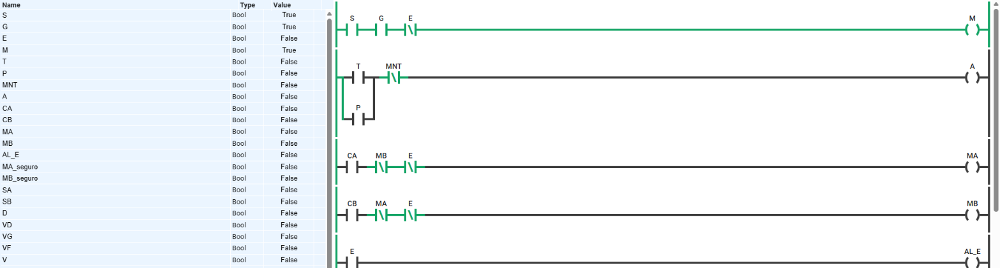

| P07 — motor liberado | P08 — emergência | P03 — proteção aberta |
|---|---|---|
|  | 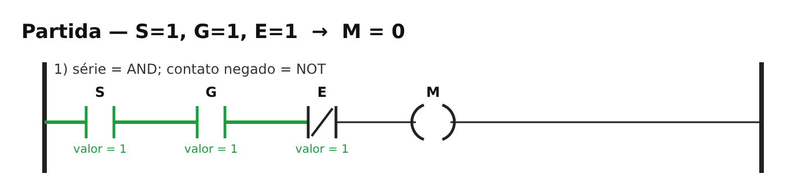 | 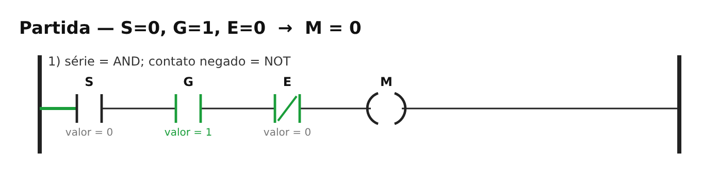 |

Outros programas: [`ladder/02-alarme-condicionado.png`](ladder/02-alarme-condicionado.png), [`ladder/05-intertravamento-emergencia.png`](ladder/05-intertravamento-emergencia.png).

## 5. Exercícios adicionais

### 5.1 Sensores discordando — `D = A XOR B`

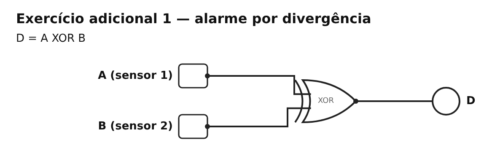
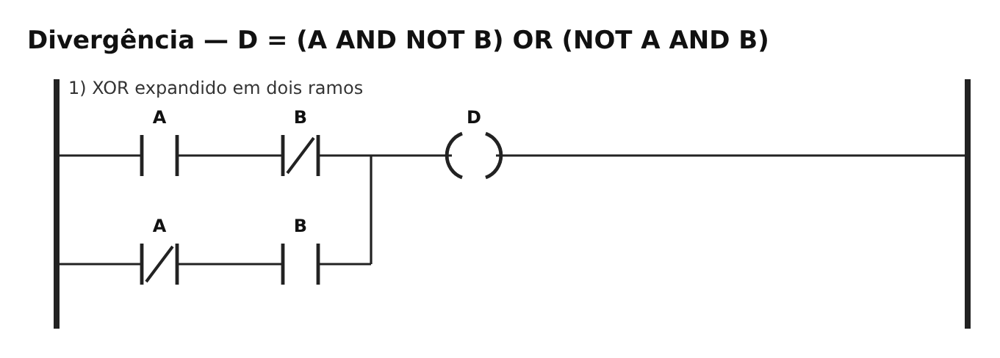

| A | B | D | O que significa |
|---|---|---|---|
| 0 | 0 | 0 | concordam |
| 0 | 1 | 1 | discordam |
| 1 | 0 | 1 | discordam |
| 1 | 1 | 0 | concordam |

Os dois concordarem não garante que estão certos (podem estar errados juntos), e quando discordam não dá para saber qual está errado.

### 5.2 Ventilação — `V = D AND G AND NOT F`

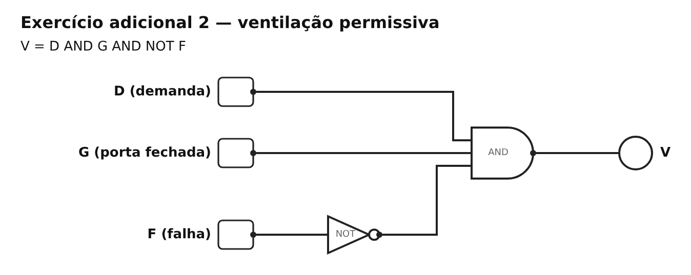
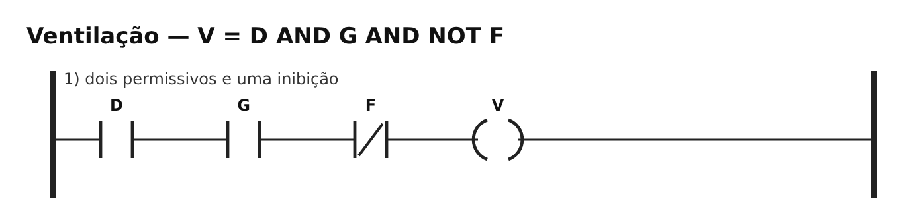

| D | G | F | V esperado | V deu | Resultado |
|---|---|---|---|---|---|
| 0 | 0 | 0 | 0 | 0 | ok |
| 0 | 0 | 1 | 0 | 0 | ok |
| 0 | 1 | 0 | 0 | 0 | ok |
| 0 | 1 | 1 | 0 | 0 | ok |
| 1 | 0 | 0 | 0 | 0 | ok |
| 1 | 0 | 1 | 0 | 0 | ok |
| 1 | 1 | 0 | 1 | 1 | ok |
| 1 | 1 | 1 | 0 | 0 | ok |

Com a ventilação ligada, mudar F para 1 desliga na hora.

### 5.3 Dois motores — A tem prioridade

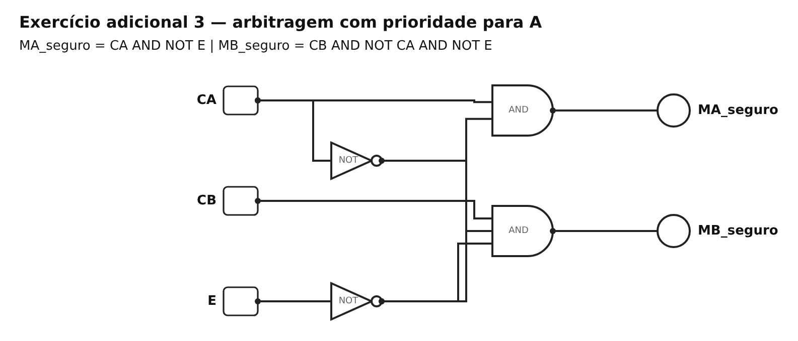
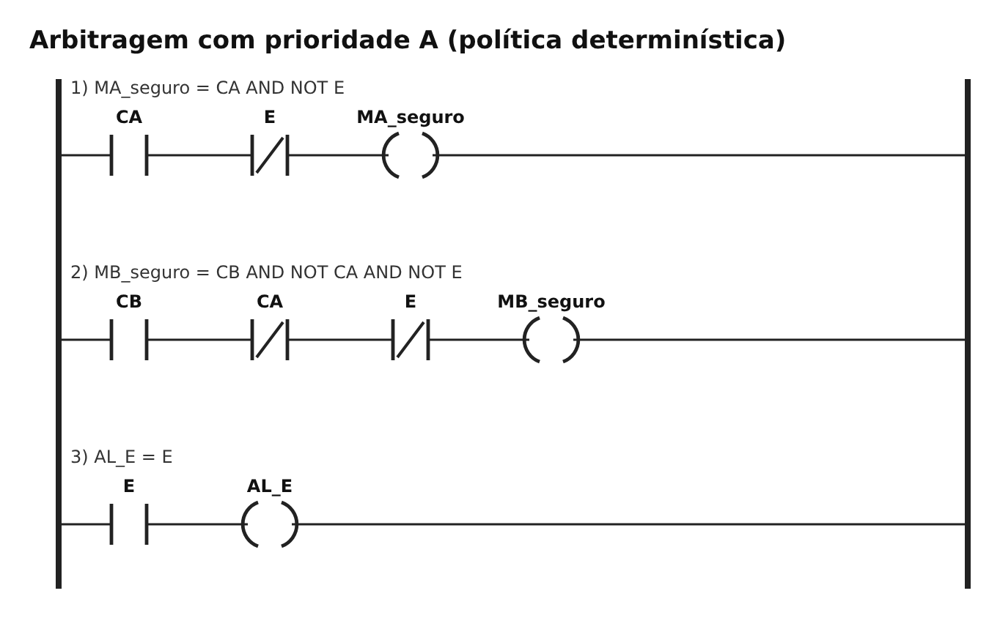

Aqui não depende de quem estava ligado antes: se pedir os dois, liga o A.

| CA | CB | E | MA | MB |
|---|---|---|---|---|
| 0 | 0 | 0 | 0 | 0 |
| 0 | 1 | 0 | 0 | 1 |
| 1 | 0 | 0 | 1 | 0 |
| 1 | 1 | 0 | 1 | 0 |
| qualquer | qualquer | 1 | 0 | 0 |

## Testes e prints

Os 57 testes estão em [`casos_teste.csv`](casos_teste.csv). Fiz todos no CircuitVerse e no PLC Simulator, e todos passaram.

| Print | O que mostra |
|---|---|
| `circuitverse-visao-geral.png` | os 7 circuitos montados |
| `circuitverse-partida-P07.png` | S=1, G=1, E=0 → motor liga |
| `circuitverse-emergencia-P08.png` | S=1, G=1, E=1 → motor não liga |
| `circuitverse-intertravamento-I6.png` | pedi A e B juntos → só A liga |
| `ladder-partida-P07.png` | o mesmo no Ladder |
| `ladder-emergencia-P08.png` | emergência bloqueia o motor e acende o alarme |
| `ladder-intertravamento.png` | A e B pedidos → só A liga |

## Active recall

1. **De frase para lógica:** separar cada condição em verdadeiro/falso, trocar "e" por AND, "ou" por OR e "não" por NOT, colocar parênteses e testar todas as combinações.
2. **XOR em vez de OR:** quando quero saber se são diferentes. Com os dois em 1, o OR dá 1 e o XOR dá 0.
3. **AND e OR no Ladder:** AND é em série, OR é em paralelo, NOT é contato fechado.
4. **O caso que pega `(S AND G) OR NOT E`:** S=0, G=0, E=0. Liga o motor sem ninguém pedir.
5. **Falha segura:** emergência ou qualquer impedimento desliga tudo que se mexe.
6. **Para outra pessoa conseguir repetir:** links abertos, expressões, o que é 0 e 1, tabelas com esperado e obtido, e os prints.

## Conclusão

Requisito, expressão, tabela, circuito e Ladder deram o mesmo resultado em todas as combinações. No intertravamento vi que, com os dois pedidos juntos, o resultado depende de quem já estava ligado. Por isso deixei definido que o A ganha.

Uma porta lógica ou uma linha de Ladder mostra a lógica, mas não garante segurança de verdade. Isso depende dos componentes, da fiação e de normas próprias, e a simulação não testa contato colado, fio solto nem tempo de parada.
